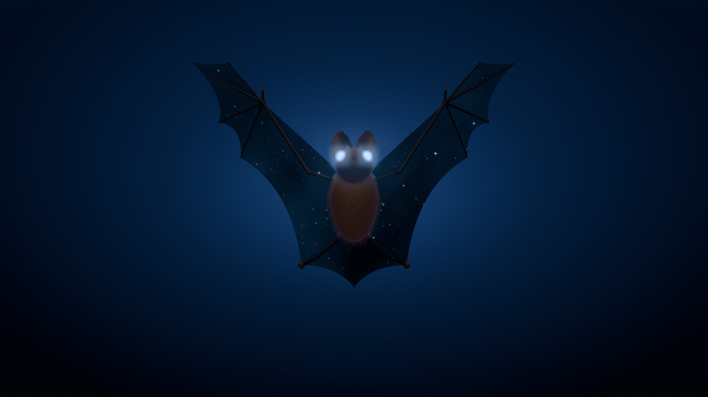
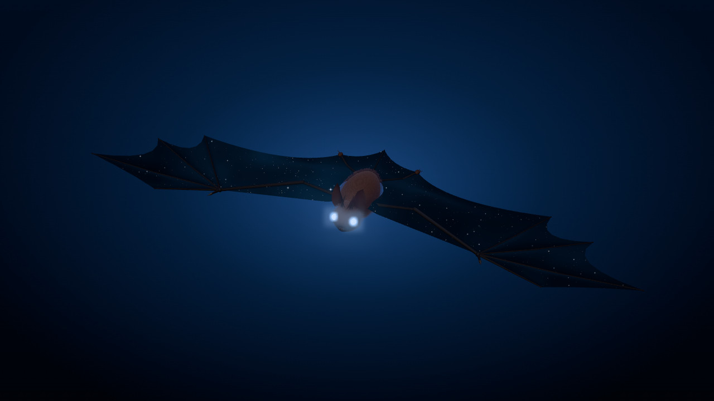
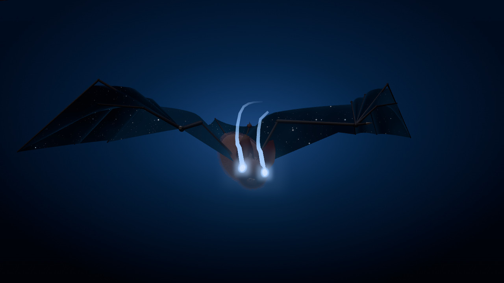
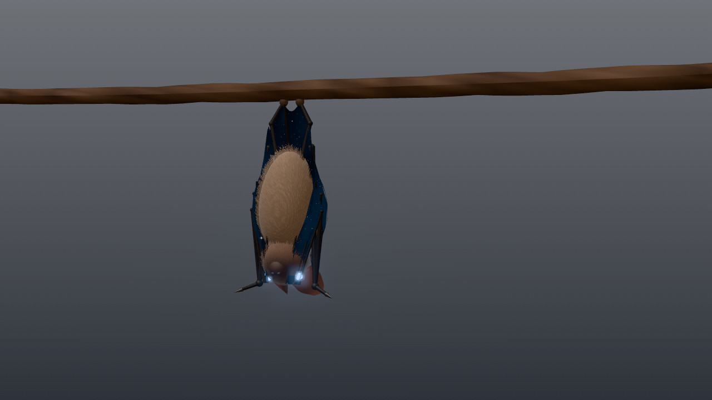

# Нетопырь — маскот



Летучая мышь, которая время от времени появляется в играх Славы Волкова. Идея самого Славы (27.10.2026): «иногда просто пролетают, иногда сидит смотрит». Цель: увидев четвёртую игру, человек замечает знакомую штучку и думает «что-то она мне напоминает».

Нетопырь — маскот, а не аватар. Аватар остаётся прежним (28.10).

**Посмотреть в 3D:** открыть [`netopyr.html`](netopyr.html) в браузере, двойным кликом прямо с диска. Нужен интернет: three.js грузится с jsDelivr.

## Главное: звёздные крылья и глаза со следом

Эти две приметы делают мышь нашей. Без них это просто нетопырь.

**Звёздные крылья.** Сквозь перепонки видно ночное небо, будто крыло — окно в ночь.

- Звёзды тихие: мелкие, бело-голубые, мерцают медленно.
- У неба три слоя глубины. Когда мышь движется, дальние звёзды сдвигаются меньше ближних. Поперёк идёт едва заметная полоса холодной дымки.
- Кожа перепонки почти чёрная, тёплого просвета нет. У костей и на крыле, повёрнутом ребром, звёзды тускнеют.



**Холодные глаза со следом.** Глаза светятся холодным бело-голубым, `#9ccaff`, и оставляют за собой два тонких светящихся следа.

- След живёт 0,2 секунды: к хвосту сужается и гаснет.
- Глаза обязательно холодные. Слава: «но тогда глаза должны быть тоже холодные, иначе не будет сочетаться» со звёздными крыльями.



Яркость звёзд, глаз и следа задаёт одна ручка `glow` (0…1). У маскота она стоит на 0.4: Слава просил «чуть незаметнее».

## Приметы

- **Вид.** Нетопырь-карлик (*Pipistrellus pipistrellus*), одна из самых маленьких летучих мышей Европы. Пропорции настоящие.
- **Стиль.** Строгий и реалистичный: не мультяшный и совсем не пиксельный.
- **Мех.** Короткий, тонкий, тёмно-бурый, брюшко светлее. Мордочка короткая, тёмная.
- **Уши.** Округлые, с козелком, развёрнуты вперёд.
- **Крылья.** Размах около 5,3 длины тела (голова плюс туловище). Четыре пальца и коготь большого пальца. Между ногами — перепонка с хвостом.
- **Цвета.** Мех `#6d5140`, брюшко `#8e735e`, мордочка `#3f2f26`, уши `#2a211c`, перепонка `#231d19` (под звёздами почти чёрная), свечение глаз `#9ccaff`.

## Повадки

- По прямой не летает: курс и высота всё время чуть гуляют.
- Машет часто, 11 раз в секунду, и глубоко. Планирует с чуть поднятыми крыльями.
- Висит вниз головой на ветке, крылья обёрнуты вокруг тела. Переступает по ветке, от каждого шага раскачивается, крутит головой, моргает, поводит ушами.
- Садится так: подлетает, задирается, переворачивается и цепляется ногами. Взлетает так: отпускает ветку, падает и раскрывает крылья на лету.



## Анимации

В просмотрщике восемь анимаций, клавиши 1–8.

| | Анимация | Что делает |
|---|---|---|
| 1 | Полёт | машет на месте, никогда не ровно |
| 2 | Зависает | тело вертикально, голова ровно, висит в воздухе перед тобой |
| 3 | Планирует | планирует, посередине три быстрых взмаха |
| 4 | Висит | висит на ветке: переступает, раскачивается, смотрит по сторонам |
| 5 | Посадка | прилетает слева и цепляется за ветку |
| 6 | Взлёт | отпускает ветку, падает, улетает вверх и вправо |
| 7 | Как на аве | летит на тебя, крылья вверх, глаза на тебя |
| 8 | Крылья раскрыты | неподвижно, крылья раскрыты полностью |

Управление: тянуть мышью — вращать, колесо — ближе, Shift и тянуть — сдвинуть, двойной клик — центр сюда. Пробел — пауза, ← → — кадр (с Shift по 10). R — вернуть камеру, G — мышь следит за тобой головой, A — облёт, L — повтор, B — фон (Студия, Небо, Ночь), [ ] — скорость.

Картинки в этом файле — кадры из просмотрщика: «Как на аве» и «Крылья раскрыты» на фоне «Ночь», «Взлёт» (кадр 62, крупно), «Висит» на фоне «Студия».

## Файлы

- `netopyr.html` — просмотрщик, один файл.
- `netopyr.js` — та же модель с анимациями, ES-модулем для игр на three.js.
- `img/` — картинки для этого файла.
- `src/` — исходники. Оба файла выше собираются из них, руками их не правят. После правки: `node brand/mascot/src/build.mjs`.
  - `rig.js` — модель: мех, перепонки, звёздное небо, глаза и их следы.
  - `species.js` — нетопырь: пропорции, цвета, ритм.
  - `clips.js` — анимации, это чистые функции времени.
  - `viewer.js`, `shell.html` — страница просмотрщика. `sky.jpg` — фон «Небо».
  - `utils.js` — мелкие помощники.

## В игре на three.js

```js
import * as THREE from 'three'
import { BatView, NETOPYR, CLIPS, base, TIME, PXU } from './netopyr.js'

const bat = new BatView(NETOPYR, { shadow: true }) // ещё env, shells (24), glow (0.4)
scene.add(bat.g, bat.fxg)                          // мышь и следы глаз — в одного родителя

// каждый кадр
TIME.value += dt                                   // мерцание звёзд
PXU.value = renderer.getPixelRatio()
const b = base()
CLIPS[0].fn(t, b)                                  // или свой полёт: b.x, b.y, b.z, b.q
bat.pose(b)
bat.tick(dt, px, toCamera)
```

- `px` — сколько единиц мира приходится на один CSS-пиксель на расстоянии мыши. `toCamera` — единичный вектор от мыши к камере, `[x, y, z]`: след развёрнут к камере. Четвёртый аргумент `true` перестаёт оставлять след, например пока мышь за кадром.
- Масштаб анимаций: `K = 54` единицы мира на длину тела.
- Глаза и следы ярче 1, поэтому ореол вокруг них даёт только bloom. В просмотрщике стоит `UnrealBloomPass` (сила 0.62, радиус 0.42, порог 1) и `NeutralToneMapping`.
- На Mac перед bloom нужен проход, который обнуляет NaN. Без него по экрану ползут чёрные квадраты. Готовый проход есть в `src/viewer.js`.
- Проверено на three 0.170 и 0.186.

Для Unity мышь придётся переносить: модель процедурная, это код на three.js, готового FBX нет. Все числа лежат в `src/species.js` и `src/clips.js`, шейдер звёзд — `GLSL_SKY` в `src/rig.js`.

## Как к этому пришли

- 27.10. Слава предложил мышь, которая повторяется в его играх. Мультяшные варианты не подошли: «хочется что-то более строгое в линиях, более минималистичное, но не пиксельное совсем, более реалистичное». Ещё он хотел одну особенность, которой не бывает в жизни.
- 27.10. Из десяти видов в 3D выбрал нетопыря: «нетопырь прикольный вроде, можно было бы скомбинировать с крыльями звездными, только этот шейдер красиво доделать и чуть незаметнее, но тогда глаза должны быть тоже холодные».
- 28.10. Аватар с мышью не прижился, нетопырь остаётся маскотом. Главное в нём: «крылышки со звездами и глазки светятся и оставляют за собой трэйл».
